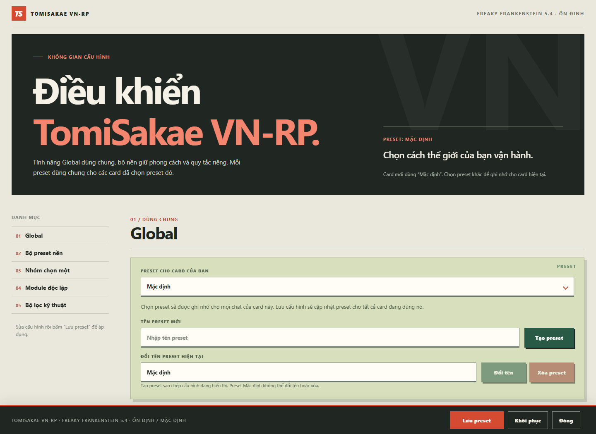
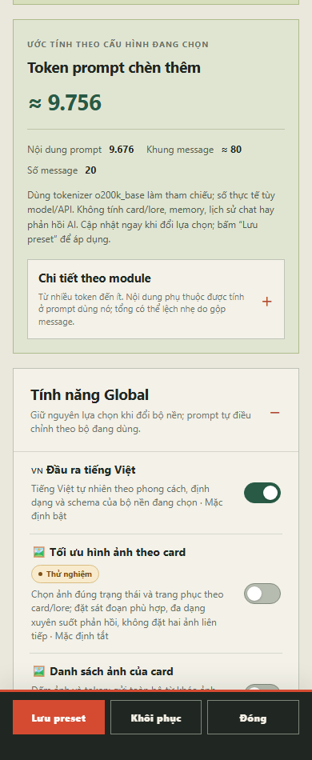
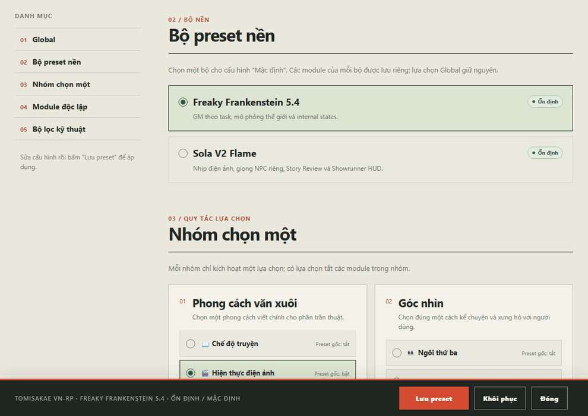

<div align="center">

# TomiSakae VN-RP

**Plugin nhập vai tiếng Việt cho RisuAI và PocketRisu**

Freaky Frankenstein 5.4 · Sola V2 Flame

[](package.json)
[](#cài-đặt)
[](src/)
[](#bắt-đầu-sử-dụng)

[Cài đặt](#cài-đặt) · [Tính năng](#tính-năng) · [Phát triển](#phát-triển) · [Đóng góp](#đóng-góp)



</div>

TomiSakae VN-RP đưa hai bộ preset vào một bảng cấu hình tiếng Việt: chọn module, đổi bộ nền, theo
dõi token và lưu cấu hình riêng cho từng card. Plugin giữ thứ tự prompt, role, macro và định danh kỹ
thuật của preset; phần Việt hóa điều chỉnh ngôn ngữ đầu ra theo cách viết riêng của từng bộ.

## Hai bộ preset nền

| Bộ preset                   | Trạng thái | Đặc trưng                                                                          |
| :-------------------------- | :--------- | :--------------------------------------------------------------------------------- |
| **Freaky Frankenstein 5.4** | Ổn định    | GM theo task, mô phỏng thế giới, cơ chế DC/roll và trạng thái `<internal_states>`. |
| **Sola V2 Flame**           | Ổn định    | Nhịp điện ảnh, giọng NPC riêng, Story Review, scene header và Showrunner HUD.      |

Lựa chọn module và regex của từng bộ được lưu riêng. Khi đổi bộ nền, các tính năng Global vẫn giữ
nguyên, còn prompt hỗ trợ tự chuyển sang phiên bản phù hợp.

## Tính năng

| Tính năng                        | Hoạt động                                                                                                           | Mặc định           |
| :------------------------------- | :------------------------------------------------------------------------------------------------------------------ | :----------------- |
| **Đầu ra tiếng Việt**            | Điều chỉnh prompt, ví dụ đầu ra và nhãn hiển thị theo từng bộ nền; giữ khóa, thẻ và cú pháp cần cho xử lý kỹ thuật. | Bật                |
| **Màu hội thoại theo giao diện** | Điều chỉnh bảng màu theo nền sáng/tối, giữ tên màu và hiệu ứng riêng của preset.                                    | Bật                |
| **Tối ưu hình ảnh theo card**    | Ưu tiên ảnh trang phục, tư thế/trạng thái rồi đến biểu cảm; dùng ảnh có sẵn và phân bố theo diễn biến.              | Tắt · Thử nghiệm   |
| **Danh sách ảnh của card**       | Đếm ảnh/token và gửi từ khóa ảnh bằng tin user riêng ngay sau tin user mới nhất.                                    | Tắt                |
| **Fix Gemma 4**                  | Ghép lời nhắc ngắn về tiếng Việt, cú pháp ảnh và kiểm soát NSFW mức 0–3 vào cuối tin user mới nhất trong request.   | Tắt                |
| **Biên tập bằng Submodel**       | Viết lại phản hồi AI cuối theo bộ nền đang dùng; lưu thành swipe mới để giữ bản gốc.                                | Tắt · Thử nghiệm   |
| **Tự động biên tập**             | Chạy Submodel sau khi phản hồi hoàn tất; cần bật Biên tập bằng Submodel.                                            | Tắt · Thử nghiệm   |
| **Âm báo hoàn tất**              | Báo thành công hoặc thất bại; khi tự biên tập, chờ Submodel kết thúc.                                               | Tắt                |
| **Ước tính token**               | Tính cục bộ lượng prompt plugin chèn thêm và chi tiết theo module.                                                  | Có sẵn             |
| **Dọn ngữ cảnh & phục hồi**      | Lưu ẩn state/tracker bị cắt theo độ sâu, phục hồi khi xóa tin, đổi swipe hoặc rẽ nhánh.                             | Theo bộ lọc đã bật |

<details>
<summary><strong>Xem giao diện trên điện thoại</strong></summary>

<p align="center">
  
</p>

</details>

### Thao tác trực tiếp trong bảng cấu hình



## Cài đặt

**Yêu cầu:** RisuAI có Plugin API 3.0. Các tính năng Submodel, tự biên tập và swipe cần API chat
output của PocketRisu.

1. Build plugin theo [hướng dẫn bên dưới](#phát-triển) để tạo
   `dist/tomisakae-vn-rp-plugin-2.0.1.js`.
2. Trong RisuAI/PocketRisu, mở **Plugin Settings → Import Plugin** và chọn file đó.
3. Cấp quyền plugin yêu cầu: xử lý request, đọc database và `mainDom`.
4. Mở card, chọn **TomiSakae VN-RP** trong menu chat để cấu hình.

Plugin không cần dịch vụ riêng. Model, API, sampling và preset Submodel được cấu hình tại ứng dụng
chủ; build chỉ lấy prompt/regex từ JSON nguồn.

## Bắt đầu sử dụng

1. **Chọn preset cấu hình** cho card, hoặc nhập tên rồi bấm **Tạo preset** để sao chép cấu hình hiện
   tại.
2. **Điều chỉnh Global**, sau đó chọn **Freaky Frankenstein 5.4** hoặc **Sola V2 Flame**.
3. Chọn các mục trong **Nhóm chọn một**, rồi bật/tắt **Module độc lập** và **Bộ lọc kỹ thuật** theo
   nhu cầu.
4. Bấm **Lưu preset** để áp dụng. Đóng bảng khi có thay đổi chưa lưu sẽ hiện xác nhận.

Card mới dùng preset **Mặc định**. Việc gán preset được nhớ theo `chaId`, áp dụng cho mọi chat của
card. Lưu một preset cập nhật tất cả card đang dùng preset đó.

**Đổi bộ nền sẽ tự lưu cấu hình đang hiển thị trước khi chuyển.** Các công tắc thông thường cần bấm
**Lưu preset**. **Khôi phục** đưa cấu hình về mặc định của bộ nền đang chọn; preset Mặc định không
thể đổi tên hoặc xóa.

<details>
<summary><strong>Token, lịch sử và tương thích: những điểm cần biết</strong></summary>

- **Token hiển thị là ước tính**, dùng `o200k_base` sau khi bung macro và áp dụng tiếng Việt/theme.
  Không gồm toàn bộ card/lore, memory, lịch sử chat, phản hồi hay request Submodel. Con số có thể
  thay đổi theo card và khác tokenizer của model/API.
- **Dọn ngữ cảnh thực sự cắt dữ liệu khỏi lịch sử và request**, đồng thời giữ snapshot ẩn theo
  tin/swipe để phục hồi. FF5.4 và Sola dùng các ngưỡng giữ state riêng của bộ lọc.
- **Sola giữ header trong lịch sử**; bộ lọc header chỉ cắt khỏi request theo độ sâu. HUD/tracker
  được giữ hoặc cắt theo từng bộ lọc, không phải mọi phần đều có cùng tuổi thọ.
- **Tắt module Sola** cũng loại các lời nhắc phụ thuộc tương ứng trong prompt khác. Những luật độc
  lập thuộc các module còn bật vẫn được áp dụng.
- **Submodel** giữ prompt/card/lore, hai lượt trao đổi AI gần nhất và tin user hiện tại, bỏ
  memory/summary. Request lỗi hoặc bị ngắt giữ phản hồi gốc.
- **JSON nguồn được giữ nguyên**. Các điều chỉnh ngôn ngữ, hiển thị, phụ thuộc module và lịch sử
  được thực hiện trong mã plugin.
- **Quyền `mainDom`** phục vụ nút viết lại và theo dõi request kết thúc để báo âm thanh. Cấu hình
  lưu trong `pluginStorage`.

</details>

## Phát triển

**Môi trường:** Node.js từ **20.19**, pnpm **11.9.0** theo trường `packageManager`. Chạy các lệnh từ
thư mục gốc repository:

```bash
git clone https://github.com/PhuVinhAI/asmr-manga-prompt-compiler.git
cd asmr-manga-prompt-compiler
pnpm install --frozen-lockfile
pnpm build
```

Kết quả: **`dist/tomisakae-vn-rp-plugin-2.0.1.js`**. Tên file tự lấy phiên bản từ `package.json`.
File này đã gộp mã plugin và hai preset nguồn, có thể import trực tiếp vào ứng dụng chủ.

| Lệnh               | Mục đích                                                         |
| :----------------- | :--------------------------------------------------------------- |
| `pnpm build`       | Build plugin, lấy phiên bản từ `package.json`.                   |
| `pnpm build:check` | Kiểm tra file build có khớp mã nguồn hiện tại.                   |
| `pnpm check`       | Kiểm tra kiểu TypeScript và ESLint.                              |
| `pnpm test`        | Chạy toàn bộ test.                                               |
| `pnpm test:watch`  | Chạy test trong quá trình phát triển.                            |
| `pnpm format`      | Định dạng mã và tài liệu bằng Prettier.                          |
| `pnpm run ci`      | Kiểm tra định dạng, kiểu/lint, build, test và độ khớp bản build. |

### Cấu trúc dự án

```text
.
├── src/                 Mã plugin, prompt thích ứng và giao diện
├── source/              Hai preset JSON nguồn
├── scripts/             Build và xuất báo cáo đối chiếu
├── test/                Kiểm thử module và tích hợp plugin
├── comparison/          Tài liệu đối chiếu prompt gốc và bản Việt hóa
├── docs/images/         Ảnh và minh họa giao diện trong README
├── package.json         Phiên bản, lệnh và dependency
├── pnpm-lock.yaml       Phiên bản dependency cố định
└── README.md
```

`comparison/` giữ các tài liệu đối chiếu để kiểm tra thay đổi prompt và được đưa vào Git. `dist/`,
`coverage/` và `node_modules/` là các thư mục sinh ra khi build, kiểm thử hoặc cài dependency; không
đưa vào Git. `dist/` chỉ chứa file plugin để import.

<details>
<summary><strong>Các điểm bắt đầu đọc mã</strong></summary>

| File                                                                                       | Trách nhiệm                                                  |
| :----------------------------------------------------------------------------------------- | :----------------------------------------------------------- |
| [`src/plugin.ts`](src/plugin.ts)                                                           | Kết nối API host, bảng cấu hình và vòng đời plugin.          |
| [`src/core.ts`](src/core.ts)                                                               | Ghép request, bung macro, lọc dữ liệu và chuẩn hóa cấu hình. |
| [`src/preset-family.ts`](src/preset-family.ts)                                             | Chọn bộ nền, thứ tự prompt và xử lý riêng theo preset.       |
| [`src/vietnamese.ts`](src/vietnamese.ts)                                                   | Prompt tiếng Việt và các phép thay thế theo từng bộ nền.     |
| [`src/image.ts`](src/image.ts), [`src/card-images.ts`](src/card-images.ts)                 | Chỉ dẫn ảnh và danh sách tài nguyên của card.                |
| [`src/gemma-fix.ts`](src/gemma-fix.ts)                                                     | Lời nhắc ngắn cho Gemma 4 và mức kiểm soát NSFW.             |
| [`src/editor-prompts.ts`](src/editor-prompts.ts)                                           | Hai prompt biên tập Submodel theo bộ nền.                    |
| [`src/sola-history.ts`](src/sola-history.ts), [`src/sola-display.ts`](src/sola-display.ts) | Dọn/phục hồi lịch sử và hiển thị Sola.                       |
| [`src/sola-prompt-dependencies.ts`](src/sola-prompt-dependencies.ts)                       | Gỡ lời nhắc phụ thuộc các module đã tắt.                     |

</details>

### Đối chiếu prompt gốc và bản Việt hóa

```bash
pnpm review:ff54
pnpm review:sola
pnpm review:sola:changes
pnpm review:sola:full
```

Các lệnh ghi báo cáo vào `comparison/`. `review:sola` xuất toàn bộ cặp prompt gốc/Việt hóa;
`review:sola:changes` chỉ liệt kê phần thay đổi cùng tóm tắt xử lý kỹ thuật; `review:sola:full` xuất
bản kiểm tra chi tiết gồm cả regex và hiển thị. Đây là tài liệu đối chiếu, không phải prompt để nạp
vào chat.

## Đóng góp

Báo lỗi hoặc đề xuất tại
[GitHub Issues](https://github.com/PhuVinhAI/asmr-manga-prompt-compiler/issues). Khi báo lỗi, ghi
phiên bản plugin, ứng dụng chủ, bộ nền, các module liên quan và các bước tái hiện. Nếu đính kèm
request hoặc log, xóa API key và thông tin riêng.

Với pull request:

1. Giữ thay đổi đúng phạm vi; giữ thứ tự, định danh và macro preset nguồn.
2. Nếu sửa prompt, kèm đoạn trước/sau và lý do; dùng lệnh đối chiếu để rà cả module mặc định tắt.
3. Bổ sung test phù hợp khi thay đổi hành vi request, lưu cấu hình, regex hoặc phục hồi lịch sử.
4. Chạy `pnpm run ci` trước khi gửi pull request.

## Nguồn preset và giấy phép

Hai preset nền **Freaky Frankenstein 5.4** và **Sola V2 Flame** thuộc tác giả gốc. Các bản JSON dùng
để build nằm trong [`source/`](source/); plugin lưu dấu SHA-256 để nhận diện nguồn.

Repository hiện chưa có tệp `LICENSE` quy định quyền sử dụng và phân phối mã plugin. Việc công khai
mã nguồn không thay thế giấy phép; quyền đối với preset và nội dung bên thứ ba vẫn thuộc chủ sở hữu
tương ứng.
